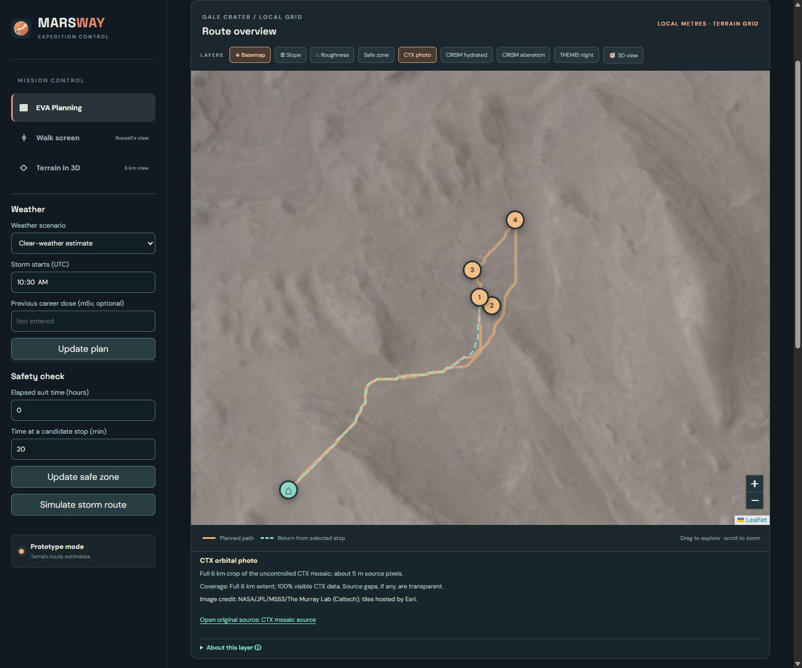
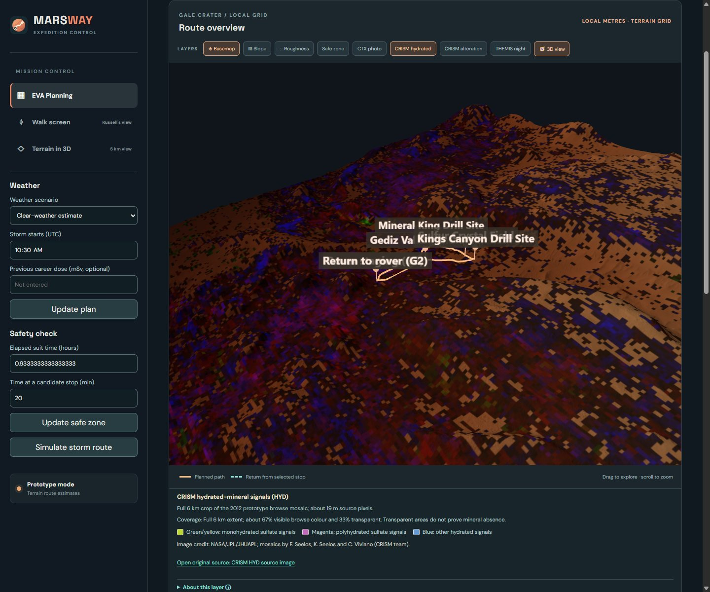

# Kelly: full 6 km orbital layers

Prepared 15 November 2026 from main `701893a`. All four delivered rasters are
**1200 × 1200 RGBA**, with **5 m output spacing** and **row 0 at the north**.
The projected extent is west **8141000**, east **8147000**, south **-287000**,
north **-281000**, in the DEM's Mars 2000 sphere / equidistant cylindrical CRS.
The first pixel centre is (8141002.5, -281002.5); the last is
(8146997.5, -286997.5). Rounded geographic bounds are 137.34359–137.44482°E,
4.84186–4.74064°S.

| Layer | Delivered source spacing | Visible pixels in the 6 km crop | Interpretation |
| --- | ---: | ---: | --- |
| CTX | about 5.09 m | 100% | Uncontrolled orbital context photo; not calibrated reflectance or precise registration. |
| CRISM HYD | about 19.295 m | 67.13396% | Qualitative hydrated-mineral browse colours. |
| CRISM ALT | about 19.295 m | 67.03410% | Qualitative alteration browse colours. |
| THEMIS night | about 162.8 m | 100% | Relative night IR brightness; about 37 source pixels across the area. Not calibrated temperature, current weather or thermal inertia. |

CRISM's remaining roughly 33% is transparent. Both source mosaics' rectangular
extents contain the whole requested crop; black browse pixels within those
extents are also transparent. They may represent absent coverage, dust, weak
signal or the browse stretch floor, not necessarily absent minerals. The
visible-colour percentages are not a measurement of instrument observation
coverage or mineral abundance. All layer panels show a coverage statement
without needing to expand the detailed explanation.

The new files overwrite the same four PNG names and three JSON sidecars in
`app/public/terrain/` and `data/processed/`. Those copies are byte-identical.
**The exporter input is the active `app/public/terrain/area.json`.** The older
`data/processed/area.json` is still a different, 3 km terrain product; this work
does not alter that terrain dataset.

## Sources and processing

- CTX: [Murray Lab global CTX mosaic](https://murray-lab.caltech.edu/CTX/),
  beta01 uncontrolled, from the [Esri service](https://astro.arcgis.com/arcgis/rest/services/OnMars/CTX/MapServer).
  Credit: NASA/JPL/MSSS/The Murray Lab (Caltech); hosted by Esri. Twelve tiles at
  zoom 12 (rows 2155–2158, columns 7221–7223) were sampled at output pixel centres.
  Bilinear resampling uses premultiplied source alpha; empty black service
  pixels are transparent, avoiding dark borders around gaps.
- CRISM: [Gale prototype browse mosaics](http://crism.jhuapl.edu/msl_landing_sites/index_news.php),
  [HYD PNG](http://crism.jhuapl.edu/msl_landing_sites/2012July_Mosaics/HYD/MSL_gale_crater_targeted_mosaic_HYD_120723.png)
  and [ALT PNG](http://crism.jhuapl.edu/msl_landing_sites/2012July_Mosaics/ALT/MSL_gale_crater_targeted_mosaic_ALT_120723.png),
  with each product's `.tfw` world file. Credit: NASA/JPL/JHUAPL; mosaics by
  F. Seelos, K. Seelos and C. Viviano. Nearest-neighbour sampling preserves browse
  colours, with transparent outside-source and black pixels. The source windows
  are columns 561–871 and rows 1415–1725. HTTP is the working original endpoint;
  the HTTPS probe timed out.
- THEMIS: [NASA Mars Trek mosaic capabilities](https://trek.nasa.gov/tiles/Mars/EQ/Mars_MO_THEMIS-IR-Night_mosaic_60N60S_100m_v14_clon0_ly/1.0.0/WMTSCapabilities.xml),
  night IR v14, nominal 100 m source mosaic, delivered tiles about 162.8 m at
  zoom 8. Credit: NASA/JPL-Caltech/Arizona State University, via NASA Mars Trek.
  Nearest-neighbour sampling preserves its coarse appearance. Explicit source
  transparency and zero-valued empty pixels are kept transparent.

Responses are cached under ignored `data/raw/science-cache/`. Network failures
raise errors; they are not silently converted into transparent source gaps.
Source response bytes are retained locally for repeatable exports.

From the repository root:

```powershell
python scripts/prepare_ctx.py --area app/public/terrain/area.json --px 1200
python scripts/prepare_crism.py --area app/public/terrain/area.json --px 1200
python scripts/prepare_themis.py --area app/public/terrain/area.json --px 1200
python scripts/test_science_raster.py
npm.cmd --prefix app run build
node app/src/eva-07-08.test.js
```

## Placement and review

`app/src/main.js` now uses `[[0, 0], [6000, 6000]]` for 2D science bounds and
`{x0: 0, y0: 0, x1: 6000, y1: 6000}` for 3D composition. Both use the same
north-up images. After Aaron's #53 merged, main's complete multi-layer 3D
implementation was retained. Kelly's `main.js` diff against main is now exactly
the two bounds changes above; Kelly's earlier single-layer wiring fix has been
removed. `planning3d.js` is unchanged from main. A remotely committed merge
still contained conflict markers in `main.js`; those have been removed by
restoring main's version and reapplying only the bounds. Aaron should review
the resulting two-line integration change.

- [Georeferencing review](review/2026-11-15/layers-6km/georeferencing-review.json):
  each old 600 × 600 crop exactly equals rows 520–1119, columns 120–719 of the
  new 1200 × 1200 raster, including alpha. This checks crop extension rather
  than stretching the old image to fill a bigger map.
- All eight boxwork/Gediz stop coordinates map into the new extent. CTX and
  THEMIS are visible at each. Both CRISM products are transparent at Sulfur
  Crystals and Kings Canyon; they remain transparent in both views.
- [Browser audit](review/2026-11-15/layers-6km/browser-review.json): all four
  layers checked on EVA-07 and EVA-08 in desktop Chrome, in both 2D and 3D.
  Leaflet image extents exactly match the terrain image. Actual 3D draw calls
  fill the full 2048 × 2048 terrain texture from (0, 0), with no old inset.
  Credits, source links, coverage statements, CRISM legends and route
  visibility were checked. Repeated 2D/3D switching produced no runtime errors.
  Sixteen screenshots are alongside the audit.
- [Post-#53 browser audit](review/2026-11-15/layers-6km/after-aaron/browser-review.json):
  repeated all sixteen layer/view checks against main `78236b9`, preserving
  Aaron's renderer and view-switching code. Evidence is in `after-aaron/`.
  A separate [multi-layer check](review/2026-11-15/layers-6km/after-aaron/multi-layer-review.json)
  verifies CTX, slope, roughness and the live safe zone compose together in 3D.
- Offline tests verify north-up source sampling, transparent outside-source
  pixels without negative-index wrapping, black-pixel interpretation, the
  1200-pixel output contract, metadata and alpha coverage, and identical copies.
  Existing EVA-07/EVA-08 terrain checks and the two-page production build pass.

These checks establish **consistent crop placement**, not precise co-registration
of the uncontrolled CTX mosaic, CRISM observations and USGS DEM. Visual checks
near the boxwork and Gediz do not certify metre-scale feature alignment.
The exploratory CTX brightness/shading correlation is weak (best 0.022), so its
best-search offsets are not measured offsets and no shift was applied.




